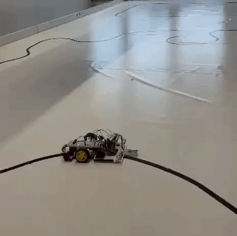

<div align="center">
  
</div>

## Overview

This Arduino program controls line-following robot using IR sensors.

The robot:

* Follows a black line using proportional and derivative correction
* Remembers the last side on which the line was detected
* Searches in the last known direction when the line is lost
* Moves slowly forward when no previous line position is known
* Controls motor speed and direction through an H-bridge motor driver

The sensors are expected to produce:

* `HIGH` when black is detected
* `LOW` when white is detected

## Control Method

The controller uses the following calculation:

```cpp
pidCorrection =
  kp * lineError +
  ki * accumulatedError +
  kd * errorDerivative;
```

The configured gains are:

```cpp
kp = 10.0;
ki = 0.0;
kd = 10.0;
```

Because `ki` is currently set to `0.0`, the robot operates as a PD-controlled line follower. The PID structure remains available if integral control is required later.

The correction is limited to:

```cpp
-10 to 10
```

This prevents excessively aggressive motor-speed changes.

## Pin Configuration

### Left Motor

| Connection | Arduino pin |
| ---------- | ----------: |
| Enable/PWM |           5 |
| Input 1    |           3 |
| Input 2    |           2 |

### Right Motor

| Connection | Arduino pin |
| ---------- | ----------: |
| Enable/PWM |          10 |
| Input 1    |           9 |
| Input 2    |           8 |

### Line Sensors

| Sensor       | Arduino pin |
| ------------ | ----------: |
| Left sensor  |           4 |
| Right sensor |          A0 |

## Motor-Speed Configuration

| Parameter                | Value |
| ------------------------ | ----: |
| Base motor speed         |   110 |
| Maximum PID correction   |    10 |
| Search inner-motor speed |    22 |
| Search outer-motor speed |    82 |
| No-line-history speed    |    50 |

## Movement States

The program handles four movement states.

### `NoLineHistory`

This state is selected when:

* Both sensors detect white
* The robot has not previously detected the line

The robot moves slowly forward:

```cpp
setMotorSpeeds(50, 50);
```

### `FollowingLine`

This state is selected when at least one sensor detects black.

The sensor error is calculated as:

```cpp
lineError = leftSensorState - rightSensorState;
```

The controller then adjusts the left and right motor speeds:

```cpp
leftMotorSpeed = BASE_MOTOR_SPEED - pidCorrection;
rightMotorSpeed = BASE_MOTOR_SPEED + pidCorrection;
```

### `SearchingLeft`

This state is selected when:

* Both sensors detect white
* The line was last detected by the left sensor

The robot turns left using:

```cpp
setMotorSpeeds(22, 82);
```

The left motor runs slowly while the right motor runs faster.

### `SearchingRight`

This state is selected when:

* Both sensors detect white
* The line was last detected by the right sensor

The robot turns right using:

```cpp
setMotorSpeeds(82, 22);
```

The left motor runs faster while the right motor runs slowly.

## Complete Sensor-Case Table

| Left sensor | Right sensor | Last detected side | Selected state   | Robot action              |
| ----------- | ------------ | ------------------ | ---------------- | ------------------------- |
| `HIGH`      | `LOW`        | Any                | `FollowingLine`  | Steers left               |
| `LOW`       | `HIGH`       | Any                | `FollowingLine`  | Steers right              |
| `HIGH`      | `HIGH`       | Any                | `FollowingLine`  | Drives straight           |
| `LOW`       | `LOW`        | Left               | `SearchingLeft`  | Searches toward the left  |
| `LOW`       | `LOW`        | Right              | `SearchingRight` | Searches toward the right |
| `LOW`       | `LOW`        | None               | `NoLineHistory`  | Moves slowly forward      |

## Sensor Error Table

| Left sensor | Right sensor |                Error | Behaviour                                       |
| ----------- | ------------ | -------------------: | ----------------------------------------------- |
| `HIGH`      | `LOW`        |                  `1` | Left motor slows down and right motor speeds up |
| `LOW`       | `HIGH`       |                 `-1` | Left motor speeds up and right motor slows down |
| `HIGH`      | `HIGH`       |                  `0` | Both motors run at the base speed               |
| `LOW`       | `LOW`        | Not processed by PID | Lost-line recovery is activated                 |

## Last-Detected-Side Memory

The program updates the last detected side only when exactly one sensor detects black.

```cpp
if (leftSensorState == HIGH && rightSensorState == LOW) {
  lastDetectedLineSide = DetectedOnLeft;
}
else if (rightSensorState == HIGH && leftSensorState == LOW) {
  lastDetectedLineSide = DetectedOnRight;
}
```

This information determines the search direction when both sensors later detect white.

## Program Flow

During every loop iteration, the program:

1. Reads both line sensors.
2. Updates the last detected line side.
3. Determines the appropriate movement state.
4. Executes the selected movement behaviour.
5. Applies the calculated motor speeds.
6. Waits for 5 milliseconds before the next iteration.

## Motor Direction

Forward motor movement uses:

```cpp
input 1 = LOW
input 2 = HIGH
```

Reverse motor movement uses:

```cpp
input 1 = HIGH
input 2 = LOW
```

A motor is stopped by setting both direction inputs to `LOW`.

## Summary

This program provides a structured two-sensor line-following system with:

* PD-based steering correction
* Four explicit movement states
* Last-known-direction recovery
* Constrained motor correction
* Centralised motor control
* Complete handling of all four sensor combinations

