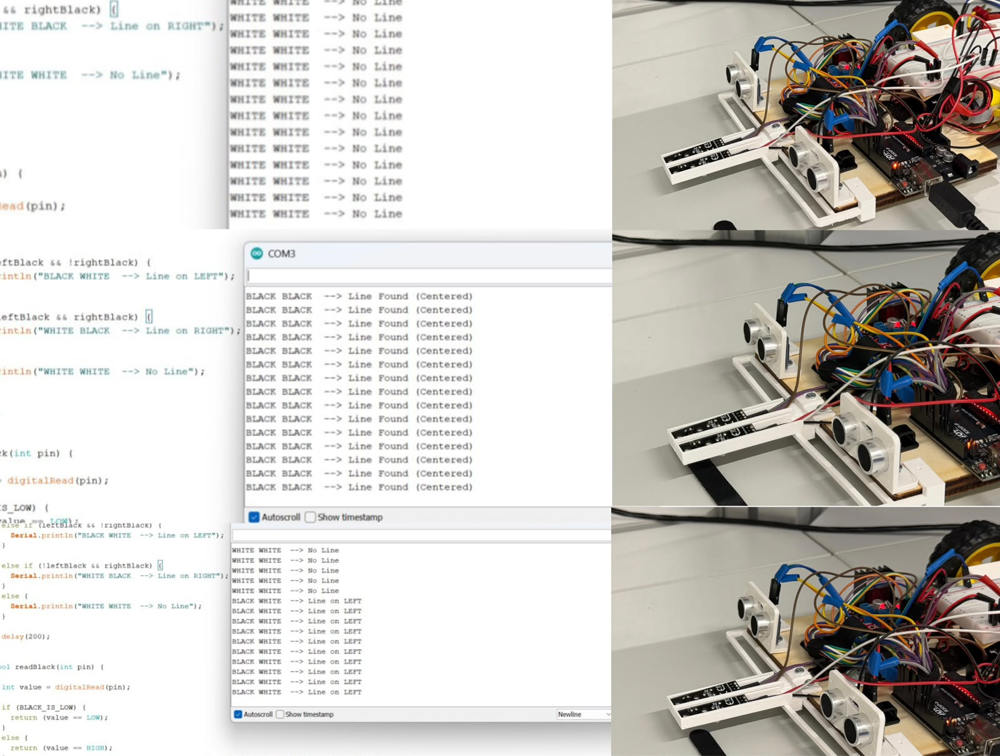

## Overview

This folder contains the standalone infrared-sensor test used during the development of the autonomous vehicle.

The test reads both IR sensors and displays the detected line position through the Arduino Serial Monitor.

<div align="center">
  
</div>

## Test Purpose

The test was used to:

- Verify that both IR sensors operated correctly.
- Confirm that each sensor distinguished the black line from the white surface.
- Adjust the onboard sensor potentiometers.
- Check the sensor behaviour at the actual mounting height.
- Identify whether the line was centred, positioned toward one side, or not detected.
- Detect hardware or calibration problems before testing the complete line-following program.

## Sensor Interpretation

The project configuration uses:

```text
HIGH = Black
LOW  = White
```

The test handles all four possible combinations of the two sensor readings.

| Left sensor | Right sensor | Serial Monitor output | Interpretation |
| --- | --- | --- | --- |
| Black | Black | `Line Found (Centered)` | Both sensors detect the track |
| Black | White | `Line on LEFT` | The line is detected by the left sensor |
| White | Black | `Line on RIGHT` | The line is detected by the right sensor |
| White | White | `No Line` | Neither sensor detects the track |

## Serial Monitor Output

When both sensors are over the white surface, the program prints:

```text
WHITE WHITE  --> No Line
```

When both sensors detect the black line, it prints:

```text
BLACK BLACK  --> Line Found (Centered)
```

When only the left sensor detects black, it prints:

```text
BLACK WHITE  --> Line on LEFT
```

When only the right sensor detects black, it prints:

```text
WHITE BLACK  --> Line on RIGHT
```

## Sensor Calibration

The onboard potentiometers were adjusted while the sensors were installed at the vehicle's operating height.

Each sensor was moved between the black line and the white surface until its output changed consistently. This calibration reduced unstable switching and helped ensure that the line-following controller received reliable sensor values.

## Component Rechecking

The test was also used during later development whenever the line-following behaviour became unstable.

Testing the two sensors separately made it possible to determine whether an unexpected movement was caused by the line-following code, incorrect calibration, a displaced sensor, or a hardware connection problem.

This prevented unnecessary changes to the main control program.

## Files

```text
ir_sensor_test.ino
ir_sensor_test.png
```

The Arduino file contains the standalone IR test, while the image shows the Serial Monitor results for different line positions.
